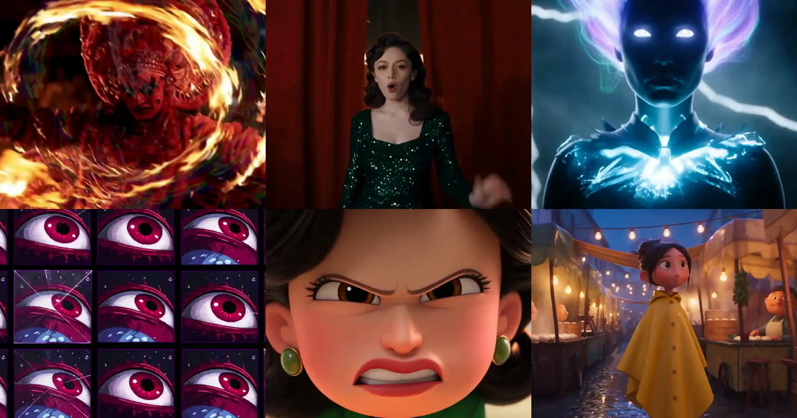

<div align="center">

<a href="https://apiko.app/ko/seedance-2-5-prompts?utm_source=github&utm_medium=banner&utm_campaign=awesome-seedance-2.5-prompts"></a>

[](../LICENSE)
[](../README_ko.md#menu)
[](https://apiko.app/ko/models/seedance-2.5?utm_source=github&utm_medium=badge&utm_campaign=awesome-seedance-2.5-prompts&utm_content=model_try)
[](https://apiko.app/docs/api-manual/video-series/seedance/seedance-2.5?utm_source=github&utm_medium=badge&utm_campaign=awesome-seedance-2.5-prompts&utm_content=docs)

[](long-form.md)
[](long-form_zh-CN.md)
[](long-form_zh-TW.md)
[](long-form_ko.md)

</div>

# ⏱️ 장편 클립 · Awesome Seedance 2.5 프롬프트

[← README로 돌아가기](../README_ko.md) · 이 페이지에 7개가 있습니다. 프롬프트는 번역하지 않은 원문입니다.

> 30초 이상 길이를 타임코드나 연속 샷 하나로 이어 가는 프롬프트.

- [런던 테크노 클럽 30초 무컷](#long-form-01)
- [하나로 이어지는 서사 판타지 롱테이크](#long-form-02)
- [한 번도 움직이지 않는 고정 카메라 30초](#long-form-03)
- [혼자 찍은 뉴욕의 하루](#long-form-04)
- [지정한 타임코드에서만 하드컷](#long-form-05)
- [일본 해안 출근길, 끊김 없는 1인칭](#long-form-06)
- [타임스탬프 대본과 스토리보드](#long-form-07)

<a id="long-form-01"></a>
### 68. 런던 테크노 클럽 30초 무컷

작성자 [@JMSvid](https://x.com/JMSvid) · 30초 · 4:3 · **[▶ APIKO에서 실행](https://apiko.app/ko/seedance-2-5-prompts?utm_source=github&utm_medium=case&utm_campaign=awesome-seedance-2.5-prompts&utm_content=long-form-01#long-form-01)** · [원본 게시물](https://x.com/JMSvid/status/2083210992343756893)

끊김 없는 한 샷을 시간 구간으로 나눠 카메라 동선을 초 단위로 계획합니다.

<video src="https://github.com/user-attachments/assets/d857c60c-ed4f-4b6b-99d1-0e0a9a979c42" width="560" controls muted playsinline></video>

**프롬프트:**

```text
Original scene, 30 seconds, one continuous shot, no cuts.

0–8 seconds: Inside a packed underground London techno club. The camera holds tightly on the face of a young English woman. She is Caucasian, brunette, with delicate features and melancholy behind her eyes. She remains centered in frame and only sways subtly with the music. Around her, the crowd moves intensely and chaotically, with bodies, arms, shoulders and faces constantly passing close to camera, creating strong motion blur and a sense of pressure and overwhelm.

Fast white strobe lights flash continuously, pushing the image back and forth between near-total darkness and sudden bursts of harsh illumination. In the darker intervals, only silhouettes, rim light, glints of sweat and fragmented movement are visible. Each flash briefly reveals fragments of her face—her eyes, cheekbones, wet strands of hair, and distant expression—before she disappears again into darkness. She feels strangely still and emotionally detached while the crowd around her becomes a mass of blurred bodies and flickering light. Heavy four-on-the-floor techno dominates the soundscape, loud, compressed and physically overwhelming.

8–16 seconds: She stays in this space for a moment longer, absorbing the intensity, then finally breaks her gaze, turns and begins pulling herself out of the crowd. The camera does not cut. It releases from the locked close-up and shifts into a close handheld follow shot, staying just behind and slightly beside her as she pushes through dancers. Bodies knock into her shoulders. Arms and backs occasionally obscure the frame. The camera feels intimate, bumped and instinctive, struggling through the same crowded space with her.

As she leaves the center of the dancefloor, the strobing becomes less dominant and the club lighting grows dirtier and more practical. She enters a narrow back passage leading away from the main room.

16–23 seconds: She moves through a cramped, dirty corridor with graffiti-covered walls, peeling paint, torn posters, exposed pipes, damp patches, flickering fluorescent lights and littered plastic cups on the floor. People lean against the walls smoking, chatting, waiting, watching others pass. She threads through them silently. The camera stays close and observational, catching the rustle of fabric, brief shoulder contact and bodies slipping past in the narrow space.

The music becomes more muffled and distant as she moves farther from the dancefloor. The heavy techno remains present only as a low, dulled throb through the walls. Footsteps, clothing friction, breathing, shuffling bodies and indistinct overlapping crowd chatter become clearer. No individual conversation is intelligible. She does not speak.

23–30 seconds: She pushes through the exit and steps into the cold London night. Outside the club, groups of people stand smoking, talking, drifting in and out of the entrance. Streetlight mixes with spill from the doorway and practical urban light. She walks to the nearest dirty exterior wall and pauses. With slightly shaky hands, she lights a cigarette. The flame briefly illuminates her face. She takes a drag, leans back against the wall, then slowly slides down into a seated position on the pavement.

The camera follows her downward and settles at her level, then holds. She sits smoking in silence, looking past the moving crowd into the distance, disconnected from everything around her. People continue crossing the frame, talking, laughing and smoking nearby, but she feels completely alone inside the busy environment.

The sound transitions from overwhelming club techno, to muffled bass and corridor ambience, to distant low-frequency vibration outside mixed with cigarette lighter clicks, breathing, street ambience, footsteps and indistinct smoker chatter. No dialogue.

The overall image should feel raw, naturalistic and grounded, with visible film grain, slight exposure fluctuation, realistic skin texture and subtle handheld instability. Avoid glossy polish, commercial beauty lighting and music-video slickness.
```

<a id="long-form-02"></a>
### 69. 하나로 이어지는 서사 판타지 롱테이크

작성자 [@VeraVCreates](https://x.com/VeraVCreates) · 30초 · 16:9 · **[▶ APIKO에서 실행](https://apiko.app/ko/seedance-2-5-prompts?utm_source=github&utm_medium=case&utm_campaign=awesome-seedance-2.5-prompts&utm_content=long-form-02#long-form-02)** · [원본 게시물](https://x.com/aicanvas_frames/status/2083383374840787223)

도시를 가로지르는 비행 경로 하나만 적어 컷이 필요 없게 합니다.

<video src="https://github.com/user-attachments/assets/e543804f-7ed7-444c-a52d-44ecfd0bf4e2" width="560" controls muted playsinline></video>

**프롬프트:**

```text
16:9, 30 seconds, an epic photorealistic fantasy cinematic long take, original worldbuilding, one continuous shot, continuous camera movement, no hard cuts, and no references to any existing film, character, actor, or recognizable cinematic scene.

OVERALL STYLE:
A high-budget fantasy film aesthetic with realistic cinematography, monumental world scale, and a beautiful protagonist with natural skin, realistic expressions, and believable body proportions. The overall tone is intelligent, elegant, mysterious, and courageous, never childish, cartoonish, or exaggerated cosplay. Four locations are connected through one continuous flight path: Iceland’s black coastline, an alternate Victorian London, a Paris-inspired city at night in the rain, and a futuristic New York-inspired aerial metropolis.

UNIFIED COLOR PALETTE:
Deep black, silver-gray, and warm gold remain the dominant colors throughout the film. Iceland adds cold blue; London adds gray-green and amber; Paris adds deep blue and wet gold; New York adds deep teal, silver-white, and gold. Maintain realistic atmospheric perspective, thin mist, rainfall, wet surfaces, glass reflections, and volumetric light throughout. Avoid a video-game look, concept-art appearance, and plastic materials.

MAIN CHARACTER:
There is only one female protagonist throughout the entire video. She is approximately 28 years old, slender, exceptionally beautiful, intelligent, elegant, and quietly determined. Her refined facial features are completely original and must not copy any real actor or movie character. She has naturally bright eyes, clearly defined eyebrows, a soft but strong facial structure, natural skin tone, realistic skin texture, and a restrained, focused expression.

She has warm chestnut-brown hair reaching her waist, naturally wavy at the ends. Part of her hair is blown behind her shoulders by the wind. Her hairstyle must remain identical throughout the entire film.

She wears a deep forest-green long coat, an ivory high-neck blouse, a dark-red knitted scarf, brown leather wrist guards, dark-gray trousers, and worn leather boots. Her costume has an elevated British fantasy aesthetic, but she does not wear a school uniform or pointed hat. Do not include badges, school emblems, magical-school symbols, recognizable character costumes, or elements from any existing film.

She rides the same original flying broom throughout the sequence: a dark, aged wooden handle with silver-gray metallic fibers at the rear and a small warm-gold light at the front. The broom’s shape, size, color, and materials must never change.

HER OBJECTIVE:
She is flying through different cities to carry the small warm-gold light toward the far edge of the clouds. She is not a combat character. She does not attack anyone or cast explosive magic. She simply continues forward through cities, coastlines, fog, rain, and high-altitude air. Her emotional progression moves from concentration to wonder, then finally to freedom and determination.

0-5 SECONDS: TAKEOFF FROM ICELAND’S BLACK-SAND BEACH
The shot begins extremely low above a black volcanic beach using a 24mm wide-angle lens. Black ocean waves are on the left, towering basalt columns on the right, and blue-white glacial mountains in the distance. Cold blue clouds press down across the sky, while a narrow line of warm golden sunset remains near the horizon.

The beautiful female traveler rapidly enters from the rear right of the frame, riding her broom just above the ocean surface. Her chestnut-brown hair streams backward in the sea wind. Her dark-red scarf creates a clean motion line behind her, while her deep forest-green coat moves naturally in the airflow. The warm-gold light at the front of the broom illuminates the sea mist and droplets of water.

The camera follows her from behind with a stable FPV movement, keeping her slightly right of center. It must not circle around to the front or allow her to leave the frame. Her body leans slightly forward; one hand holds the broom handle while the other maintains balance. She flies toward a massive wall of blue ice.

At the fourth second, she enters a natural裂缝 beneath the ice wall. The ice passes rapidly along both sides of the camera. Cold blue crystals briefly intersect with the warm-gold light, creating the first natural transition. No explosion, magical smoke, or sudden transformation.

5-12 SECONDS: VICTORIAN LONDON IN THE FOG
As the ice clears the lens, the environment naturally becomes an alternate Victorian city at night. The protagonist and broom retain exactly the same direction, speed, clothing, appearance, and flying posture. The camera continues following from behind.

Below are wet dark-gray stone streets. Red-brick buildings, black iron bridges, narrow windows, and old amber streetlamps line both sides. Several dark-red double-decker public vehicles without text or branding move slowly through the fog. The city should evoke Victorian London without reproducing real landmarks.

The camera gradually transitions from fast FPV pursuit into a smooth three-quarter rear tracking shot, moving approximately 45 degrees to her left side. Her beautiful profile appears briefly. Her eyes remain focused, and her hair and scarf maintain stable continuity. The warm-gold light leaves only a short trail through the rain and fog.

She passes beneath a black elevated iron bridge. Its steel structure moves across the top of the frame as a brief physical occlusion. The camera does not cut, and when the obstruction clears, she remains on the same movement axis.

At the tenth second, she flies into a massive arched railway station. Its roof is made from black steel beams and wet glass, with rainwater flowing across the surface. The roof completely covers the frame, creating the second natural transition.

12-19 SECONDS: PARIS-INSPIRED CITY IN THE RAIN
When the glass roof clears the camera, the environment becomes a romantic, original Paris-inspired city at night in the rain. Do not reproduce real landmarks. Preserve only the atmosphere of stone bridges, a river, narrow streets, classical stone buildings, wrought-iron balconies, and warm window light.

The protagonist flies low above a broad river. The water reflects golden windows and the deep-blue night sky. Pale-gray stone buildings, tall narrow windows, wet rooftops, and fine rain lines extend along both sides. Her deep-green coat and dark-red scarf form a clear silhouette against the blue city, while her chestnut hair streams backward.

The camera moves into a parallel tracking position on her right side. The broom stays approximately three meters above the river. The camera remains slightly below shoulder level, preserving the spatial relationship between the woman, broom, river, and architecture. She passes beneath a sequence of classical stone bridges whose arches form continuous reflections in the water.

At the seventeenth second, she enters a long mirror corridor made from wet glass walls. The reflections may show only the same woman, the same broom, and the same warm-gold light. Do not create duplicate people. Rainwater, city lights, and reflections slide along the glass surfaces.

A powerful warm-gold light appears at the end of the corridor. She flies toward it, creating the third natural transition.

19-24 SECONDS: FUTURISTIC NEW YORK-INSPIRED CITY
The mirror corridor opens into an original futuristic New York-inspired metropolis. The camera rapidly but smoothly shifts from the three-quarter rear position into a controlled forward-facing FPV shot moving backward in front of her. Her beautiful, focused face, chestnut hair, dark-red scarf, and the golden broom light are briefly visible.

Below are wet streets, glass skyscrapers, metallic elevated bridges, and enormous urban canyons. The buildings reflect golden light, a deep-teal night sky, and silver-white mist. All screens and glass surfaces must remain abstract and free of text, advertisements, logos, or branding.

She flies between two skyscrapers. The glass wall on the left passes close to the camera, while a vast urban canyon opens on the right. The camera briefly maintains its backward-facing position before completing one stable 90-degree upward movement, transitioning from her face to a position above her.

Do not spin rapidly, make her tumble, or transform the broom into an aircraft. She remains graceful, skilled, and stable.

At the twenty-third second, she bursts out from between the skyscrapers. The city lights rapidly become smaller below her, while the warm-gold light at the front of the broom becomes the only stable light source near the center of the image.

24-30 SECONDS: THE FINAL WORLD ABOVE THE CLOUDS
The camera continues rising at high speed and passes through a dense layer of cloud. When the clouds clear, the protagonist appears high above a vast cloud sea, hovering on her broom.

She gradually slows down and changes from a forward-leaning posture to a more upright position. Her chestnut hair and dark-red scarf move backward in the high-altitude wind. The camera moves from the front to her right rear side, then rises into a high-angle 24mm wide shot.

Distant traces of the four worlds appear below without forming a chaotic collage: Iceland’s black coastline and blue glacier on the far left; London-inspired red-brick structures and gray-green fog in the middle distance; Paris-inspired golden waterways and stone bridges on the right; and silver-white lights from the New York-inspired glass city at the lowest level.

These locations must exist only as distant spatial layers. Do not suddenly reproduce four complete cities or make buildings float and reorganize. A warm golden horizon appears at the edge of the clouds, suggesting that another world is waiting beyond it.

At the twenty-eighth second, the protagonist raises her right hand. The warm-gold light at the front of the broom emits one thin beam toward the horizon. The beam only illuminates a new path through the clouds. It does not explode, create a giant energy sphere, or alter her appearance.

During seconds twenty-nine to thirty, the camera becomes completely stable. The protagonist, broom, cloud sea, distant layers of the four cities, and golden horizon are all clearly visible. She appears as a beautiful but small figure near the lower center of the frame, facing the open world. The final emotion is freedom, wonder, and the sense that the journey will continue.

CAMERA AND PACING:
0-5 seconds: low-altitude rear FPV pursuit.
5-12 seconds: smooth three-quarter rear tracking through London.
12-19 seconds: parallel low-altitude tracking through Paris.
19-24 seconds: one controlled front-facing backward FPV movement through New York.
24-30 seconds: continuous rise into a high-angle wide establishing shot.
Use FPV speed only during the Iceland takeoff and New York skyscraper passage. Keep the London and Paris sections controlled, elegant, and spatially readable.

SOUND DESIGN:
Iceland: ocean waves, cold wind, low glacial rumbling, and subtle vibration from the wooden broom.
London: rain, steam, iron-bridge resonance, and distant wheels.
Paris: rain droplets, water, distant bells, and low strings.
New York: low urban rumble, wind pressure across glass, and metallic structural resonance.
Above the clouds, all city sounds gradually fade, leaving high-altitude wind, a subtle metallic resonance from the broom fibers, and one warm sustained string note.

CONTINUITY RESTRICTIONS:
Only one female protagonist appears throughout the video.
She must remain exceptionally beautiful, natural, and realistic, with stable original facial features that do not copy any actor or film character.
Her chestnut-brown hair must retain the same color, length, and hairstyle.
Her forest-green coat, ivory blouse, dark-red scarf, brown wrist guards, dark-gray trousers, and worn boots must remain unchanged.
The broom must remain the same dark aged wooden broom with silver-gray metallic fibers and a warm-gold front light.
Do not add companions or other flying characters.
Do not include pointed hats, school uniforms, magical schools, badges, school emblems, castles, recognizable film characters, superhero logos, or brand symbols.
Do not generate text, subtitles, advertisements, UI elements, logos, or readable signs.
Do not allow buildings to melt, drift, resize, or suddenly reorganize.
Do not create duplicate figures in mirrors.
Maintain realistic physical behavior for ice, rain, water, glass, fog, and clouds.
Do not use hard cuts, sudden spinning, random shaking, abrupt zooms, body deformation, face replacement, explosions, large-scale destruction, or unmotivated effects.
Keep the protagonist, broom, flying direction, city geography, and lighting transitions continuous and visually traceable.
```

<a id="long-form-03"></a>
### 70. 한 번도 움직이지 않는 고정 카메라 30초

작성자 [@sebatheepan](https://x.com/sebatheepan) · 30초 · 16:9 · **[▶ APIKO에서 실행](https://apiko.app/ko/seedance-2-5-prompts?utm_source=github&utm_medium=case&utm_campaign=awesome-seedance-2.5-prompts&utm_content=long-form-03#long-form-03)** · [원본 게시물](https://x.com/sebatheepan/status/2083290634731864190)

움직이지 않는다는 말을 반복해 연출만으로 이야기를 끌고 갑니다.

<video src="https://github.com/user-attachments/assets/8043e294-68f9-4215-af11-4655dc0f0787" width="560" controls muted playsinline></video>

**프롬프트:**

```text
A 30 second film from ONE completely locked, static camera position that never moves, never pans, never zooms, never cuts. The same view of the same patch of ground for one thousand years, time passing at enormous speed. In the foreground of every single frame sits a large mossy grey boulder. It never moves. It is present and recognisable in every frame of the film from first to last. [0:00-0:03] Ancient temperate forest. Huge old trees, deep green undergrowth, mist between the trunks, soft grey daylight. [0:03-0:06] Trees fall and are dragged away. A clearing opens. Stumps, churned mud, a first thin column of smoke. [0:06-0:09] A single timber and thatch hut rises beside the boulder. A small vegetable plot. Chickens. [0:09-0:12] A village grows around it. More huts, fences, a dirt track, wood smoke, sheep in the field beyond. [0:12-0:15] A stone wall is built, incorporating the boulder into its base. A church tower rises behind. Snow falls and melts. Seasons flicker past. [0:15-0:18] Fire. The village burns, timbers collapse, smoke blackens the sky. The wall and the boulder survive. [0:18-0:21] Rebuilding in brick. A cobbled road. A chimney, then many chimneys. Industrial smoke, grey air, rain. [0:21-0:24] The town becomes a city. Concrete rises. The old wall is demolished. The boulder sits in a small paved square, surrounded by buildings. [0:24-0:26] Glass towers. Traffic light streaking past at night. The boulder is fenced off, a small green plaque beside it. [0:26-0:28] Abandonment. Windows dark, glass cracked, weeds through the paving, ivy climbing the towers. Silence. [0:28-0:30] The towers have collapsed and gone. Young forest has grown over everything. Mist between the trunks. The frame is now identical to the opening frame, the same boulder in the same position under the same soft grey light. Camera: absolutely locked and static for all 30 seconds. No movement of any kind. No cuts, no dissolves, no transitions — one continuous transforming shot. Style: photoreal, cinematic, natural overcast light throughout, muted natural colour, seasons and weather flickering rapidly past. Audio: diegetic only, evolving with the era — forest birds, axes, village life, church bell, fire, industrial machinery, city traffic, then silence, then birds again. NO MUSIC, no score, no soundtrack, no instruments. No text, no captions, no titles, no watermarks, no camera movement, no cuts. created with @higgsfield
```

<a id="long-form-04"></a>
### 71. 혼자 찍은 뉴욕의 하루

작성자 [@noman23761](https://x.com/noman23761) · 29초 · 16:9 · **[▶ APIKO에서 실행](https://apiko.app/ko/seedance-2-5-prompts?utm_source=github&utm_medium=case&utm_campaign=awesome-seedance-2.5-prompts&utm_content=long-form-04#long-form-04)** · [원본 게시물](https://x.com/noman23761/status/2083235536530202710)

호텔에서 거리까지 하루를 순서대로 따라가는 셀프 촬영 일지입니다.

<video src="https://github.com/user-attachments/assets/0ecc7342-89de-4602-bfe9-6e0f2ec21537" width="560" controls muted playsinline></video>

> 📎 이 예시는 참조 이미지나 영상을 직접 올려야 합니다.

**프롬프트:**

```text
SCENE A day in New York shot entirely by the subject herself: waking in her hotel suite, coffee, getting ready, out into the city, back to the room at night. ACTIVE REFERENCES @ image1 — the hotel suite. Curved cove ceiling with warm LED coving, deep red carpet, cream walls, two black organic sculptures above a light wood headboard, white bedding with red pillows, twin bedside lamps, pale sofa, oval coffee table, sheer curtains, dark door. @ image2 — the subject. Young woman, shoulder-length wavy blonde hair with curtain bangs and highlights, light freckles, thin gold necklace, silver ring, dark brown off-the-shoulder knit with white diamond-stripe pattern. 100% matches the reference. CAMERA OWNERSHIP LOCK Only two positions exist. HELD: arm extended, camera 0.4-0.7m from her face, visible arm tension, tilt and step-bounce. PROPPED: camera on a surface she placed it on, crooked and fixed, with her moving in and out of frame. No operator shots, no tracking, nothing she could not have filmed alone. FORMAT Eight shots, 30s, seven HARD CUTS, no fades. Real-time. 0-4s SHOT 1 — PROPPED, morning room. 84° diagonal field of view, camera on the sideboard 3m from the bed at 1.1m, static and tilted. The suite matches @ image1: cove light on, curtains half open, cool daylight across the red carpet. @ image2 visible at 0.0s, sitting up on the bed edge x66 y58. No empty frame. She rubs her face and croaks at the running camera: "It's seven. In New York. Why am I awake." Stands, walks out screen-right. HARD CUT. 4-7s SHOT 2 — HELD, window light. 84°, arm's length 0.5m, above eye line. She is x50 y42 at the sheer curtain screen-left, cool daylight on the near side of her face, cove warmth behind. She pulls the curtain, squints at the street below, then into the lens: "Okay. It's actually happening." Arm wobble throughout. HARD CUT. 7-11s SHOT 3 — PROPPED, coffee. 47°, camera on the oval coffee table 0.8m away, low, looking up past a cup. She sits into frame at x55 y45, pours, tastes, pulls a face at the running camera: "Hotel coffee. We'll fix that outside." Steam bends in the light. HARD CUT. 11-15s SHOT 4 — HELD, mirror. 47°, camera at chest height reflected in the suite mirror. She is x45 y50 in the reflection, camera visible in her hand, working through her hair with the other. Bed and sculptures behind. At 13s: "This is as good as it gets. Let's go." HARD CUT. 15-18s SHOT 5 — HELD, leaving. 107° wide rectilinear, camera held low at waist height, turned forward. She crosses the red carpet to the door at x55, lens swinging with her stride. She opens it and corridor light floods the frame. Off-frame, breathy: "Downtown first." HARD CUT. 18-22s SHOT 6 — PROPPED, street. 47°, camera on a stoop rail 3m away, static, crooked. A New York block behind her — brownstone steps, fire escapes, yellow cabs, steam from a vent. She walks in from screen-left at 18.5s, stands at x60 y50, spreads her arms: "Look at this street." Then walks to the lens and takes it at 21.5s. Passers-by cross the foreground. HARD CUT. 22-26s SHOT 7 — PROPPED, diner. 84° wide, camera on the counter behind a plate, 0.7m from her, looking up. She is x55 y38, sits into frame, takes a bite, eyes widen, mouth full: "Okay, that's the one." Laughs, keeps eating. HARD CUT. 26-30s SHOT 8 — HELD, night, back in the room. 84°, arm's length 0.5m, held above her. She lies back across the white bedding at x50 y55, hair spread, in the brown knit again. Bedside lamps and cove light are the only sources, windows black with city glow. Into the lens: "Twenty thousand steps. Everything hurts." Softer: "Same time tomorrow." Wave, the frame tilts as she lowers the camera. 30.0s black. SPEECH Only the quoted lines are spoken, at the timings given, all in her voice. Lips still at all other times. No voiceover, no second speaker, no offscreen voices. Delivery is casual, unrehearsed, mid-breath, sometimes trailing off. Volume rises over street noise in Shot 6, near-whisper in Shot 8. CONTINUITY The suite matches @ image1 in both interior sequences — same carpet, sculptures, headboard, sofa, lamps. Hair, necklace and ring identical throughout. PHYSICS Loose knit slides on the shoulder with every arm movement. Wavy hair lags a frame behind head turns. Bedding creases under her weight. Step energy visible in every HELD frame. LIGHTING Shots 1-4: cool daylight from the curtains screen-left as key, warm cove LED as fill, red carpet bouncing warmth into the shadows. Shot 5: corridor light through the doorway. Shots 6-7: hard street daylight, warm diner practicals. Shot 8: lamps and cove light only. AUDIO Diegetic only, from the same camera — room tone, footsteps, door, traffic, sirens, steam vents, diner clatter, wind. Ambience ducks under her lines. No music. LOCKS Photoreal live action, 4K detail, fine grain, warm consumer-camera colour, mild rolling shutter and auto-exposure hunting. She is the only person who speaks; background figures anonymous and unfocused. No subtitles.

#Seedance25 #Seedance #VLOG #Higgsfield @higgsfield @noman23761
```

<a id="long-form-05"></a>
### 72. 지정한 타임코드에서만 하드컷

작성자 [@digitalwindai](https://x.com/digitalwindai) · 59초 · 16:9 · **[▶ APIKO에서 실행](https://apiko.app/ko/seedance-2-5-prompts?utm_source=github&utm_medium=case&utm_campaign=awesome-seedance-2.5-prompts&utm_content=long-form-05#long-form-05)** · [원본 게시물](https://x.com/digitalwindai/status/2083219991856304394)

컷 지점을 0.5초 단위로 적어 샷 길이를 완전히 통제합니다.

<video src="https://github.com/user-attachments/assets/ab0d1634-dca8-47f8-bacb-a7aa3532ffe9" width="560" controls muted playsinline></video>

> 📎 이 예시는 참조 이미지나 영상을 직접 올려야 합니다.

**프롬프트:**

```text
FORMAT MODE
Timed multishot with HARD CUTS only at 4.0s, 8.0s, 12.0s, 15.0s, 19.0s, 23.5s and 27.0s. The camera cuts only at these points. Real-time playback everywhere except 19.0–23.5s, which is slow motion; the speed change happens only on those two hard cuts.
STORYBOARD
SHOT 1 (0.0–4.0s)
Lateral profile close-up, 18°, camera tracking beside him at 60 km/h, level with his shoulder. He rides steady, head turning a few degrees forward as the ruins come into his sightline, then his shoulders drop slightly and he leans in. Sand streams off the board's trailing edge behind him. Low sun rakes across the front of his visor from camera-right, leaving the far side of his helmet in deep shade.
SHOT 2 (4.0–8.0s)
HARD CUT to an extreme wide, 84°, camera high and static as he crosses the frame camera-left to camera-right at 60 km/h, a small figure with a cyan thread of light beneath him. Ahead of him the ruin field opens up — collapsed slabs and leaning steel standing as tall as six humans, throwing long shadows across the salt pan.
SHOT 3 (8.0–12.0s)
HARD CUT to a low tracking shot, 47°, camera 30 cm off the ground running with him at 70 km/h as he enters the ruins. He weaves between two leaning columns, board tilting hard onto its edge, a sheet of sand and grit fanning off the tail. Broken concrete passes close on both sides. Cyan underglow flares against the slab faces as he passes them.
SHOT 4 (12.0–15.0s)
HARD CUT to a medium shot from the front quarter, 29°, camera drifting backward ahead of him at 70 km/h. He drops into a deep drift, both arms out for balance, the board sliding sideways through a curve of debris, a long curtain of dust thrown out behind him and catching the low sun. His head stays locked on his line through the turn.
SHOT 5 (15.0–19.0s)
HARD CUT to a low rear three-quarter shot, 63°, camera accelerating with him from 70 to 110 km/h. He crouches, drives his weight forward, and the board's cyan strip brightens as it surges. Ahead of him a broken roadway section rises out of the sand at a shallow angle, its torn edge lifted clear of the ground. He hits it square and launches.
SHOT 6 (19.0–23.5s)
HARD CUT into SLOW MOTION. Wide side view, 47°, camera craning slowly upward with him against the low sun. He is airborne at the apex, board still under his feet, one hand gripping the front edge, knees folded. A full curtain of sand hangs suspended around and beneath him, every grain lit gold from camera-right and drifting rather than falling. The cyan glow underneath him rakes across the suspended sand. The whole shot stays in slow motion start to finish.
SHOT 7 (23.5–27.0s)
HARD CUT back to real time. Low tracking shot, 47°, camera behind and beside him. He lands hard, board slapping the sand and compressing, a burst of grit blowing outward from the impact, and he rides straight out of it at 110 km/h across the last open stretch toward the sandstone cliffs. The ruins fall away behind him.
SHOT 8 (27.0–30.0s)
HARD CUT to a lateral profile medium shot, 29°, camera settling alongside him and coming to rest as he does. He carves the board hard sideways and brakes, throwing a low wide sheet of sand forward and to camera-right, and stops at the cliff edge. He straightens up, squares his shoulders, and turns his helmet to face the sun sitting on the horizon. Held final frame: the rider in profile at the cliff edge, sand still settling around the board, the cyan glow steady beneath him, the sun low ahead of him.
PERFORMANCE
Everything reads through the body, since his face is behind the visor: weight shifting into each turn, arms counterbalancing the drift, the deep crouch before the launch, the folded stillness at the apex, the absorbed compression of the landing, and the settled straightening at the very end. Restrained and controlled throughout — a rider who knows this ground.
PHYSICS
The board carries real mass and inertia. It leans into turns and rebounds on landing. Sand behaves as loose dry grain: it fans off the edge under load, hangs in a curtain in slow motion, blows outward in a burst on impact, and settles slowly at the end. Dust catches and scatters the low sun. Wind drags loose grit off the dune crests continuously. Debris in the ruins stays put; only sand and dust move.
LIGHTING
Fixed 3200K golden-hour sun, low on the horizon ahead of the rider and camera-right, unchanged in every shot. Hard warm key on the front of his suit and visor, deep shade on the far side, long shadows running away camera-left across the sand and the ruin floor. Airborne dust glows where it crosses the sun. Cyan board light acts as a cold practical from below, catching his boots, the sand under him and nearby slab faces.
AUDIO
The music from @video1 continues unbroken through the whole extension — same track, same key, same tempo, no restart and no new song. Under it: the low hum of the board, wind across open sand, grit spraying off the edge, concrete and steel echoing close in the ruins.
At 19.0s the mix thins for the slow-motion shot — the music drops to a single sustained low note, and the suspended sand and the board's hum sit at the front.
At 23.5s the full arrangement returns hard on the landing impact.
In the final shot the music resolves and holds under open desert wind. No dialogue anywhere.
OUTPUT SETTINGS
16:9, real-time in every segment except 19.0–23.5s, which is slow motion.
POSITIVE LOCKS
This is a continuation of @video1 — all action takes place after the source footage ends.
The rider, helmet, visor light strips, suit and the hoverboard's cyan underglow stay identical to @video1 in every shot.
The rider travels camera-left to camera-right in every lateral view, and the sun stays low and camera-right in every shot.
One continuous piece of music runs from the first frame to the last, carried over from @video1.
The board keeps complete geometry and stays under his feet through the jump and landing.
Cuts land only at the stated seconds, and the speed change to slow motion happens only at 19.0s and back at 23.5s.
The video ends on the held profile of the rider stopped at the cliff edge, facing the low sun.
```

<a id="long-form-06"></a>
### 73. 일본 해안 출근길, 끊김 없는 1인칭

작성자 [@jaynwabueze](https://x.com/jaynwabueze) · 30초 · 16:9 · **[▶ APIKO에서 실행](https://apiko.app/ko/seedance-2-5-prompts?utm_source=github&utm_medium=case&utm_campaign=awesome-seedance-2.5-prompts&utm_content=long-form-06#long-form-06)** · [원본 게시물](https://x.com/jaynwabueze/status/2083475368955072983)

컷 없이 1인칭을 유지하고 이동 경로가 이야기를 이끌게 합니다.

<video src="https://github.com/user-attachments/assets/82d6fe59-0fa3-40ee-acb7-66569b3f88e8" width="560" controls muted playsinline></video>

**프롬프트:**

```text
POV — Morning Commute in Coastal Japan | Ultra-Realistic, One Continuous Take

First-person POV, no cuts, one unbroken handheld-feeling shot from our own eyes on the way through a small seaside town. Ultra-photorealistic, phone-in-hand realism — natural camera micro-shake, subtle head bob with each step, occasional glance down at our own hands and shoes. 4K, shallow but natural depth of field, real morning light, no color-grading fantasy, no neon.

Beat 1 — Descending into the station (0–4s): We walk down worn concrete station stairs into a small coastal-town metro entrance, one hand loosely gripping a canvas bag strap that swings into the lower frame. Fluorescent tint mixes with daylight bleeding from the entrance behind us. Commuters pass in soft focus; we hear muffled announcements and the shuffle of footsteps.

Beat 2 — The orange cat (4–9s): We slow and crouch — the horizon dips as our POV lowers toward the ground. An orange tabby sits by a ticket-gate pillar, tail curled. Our hand (natural skin texture, slightly bitten nails, cuff of a sleeve) reaches into frame and gently strokes its head. The cat leans into the touch, eyes half-closing, ears flicking. We hold there a beat, warm and quiet.

Beat 3 — Boarding, settling by the window (9–14s): We rise, the horizon lifts, and we step through the train doors just as the chime sounds. POV turns and moves toward a window seat; we sit, and the frame settles against the glass. A faint silhouette of us ghosts over the view. The train pulls away with a gentle lurch.

Beat 4 — The shimmering sea (14–20s): Through the window, the town gives way to open coastline. Sunlight scatters across the water in thousands of moving sparkles — real specular glitter, not CGI bloom. Utility poles and wires strobe past in the foreground. We rest our chin lightly (subtle downward frame tilt), just watching.

Beat 5 — Rails into the sea (20–25s): The track curves and runs so close to the shore that the rails seem to vanish straight into the water — the sea fills nearly the whole frame, waves lapping right up to the ballast. Foam catches the light. We're gliding along the edge of the ocean, the horizon line steady, gulls crossing in the distance. Hold on this until the shot ends.

Technical spec: continuous POV, first-person, no cuts or transitions, natural handheld micro-motion, realistic morning ambient audio (station hum, cat, train chime, rail clatter, distant surf), authentic Japanese coastal-railway setting (Shimonada / Enoden-style seaside line), overcast-to-clear soft daylight, photoreal skin and fabric texture, 2.39:1 or 16:9, ultra-realistic.
```

<a id="long-form-07"></a>
### 74. 타임스탬프 대본과 스토리보드

작성자 [@mumaren_2](https://x.com/mumaren_2) · 30초 · 16:9 · **[▶ APIKO에서 실행](https://apiko.app/ko/seedance-2-5-prompts?utm_source=github&utm_medium=case&utm_campaign=awesome-seedance-2.5-prompts&utm_content=long-form-07#long-form-07)** · [원본 게시물](https://x.com/mumaren_2/status/2083194831569121554)

시간 구간·샷 이름·물리 지시를 비트마다 대본처럼 정리합니다.

<video src="https://github.com/user-attachments/assets/419bcd52-c1f1-408d-bb7b-971c33dca46f" width="560" controls muted playsinline></video>

**프롬프트:**

```text
[Timestamped Script \u0026 Storyboard]
[00:00 - 00:08] [High-Speed ​​Dash] — Cutting Through the Wind | Action / Physics Directive: The camera flies in close pursuit, positioned just behind and to the side of the mecha-motorcycle as it races through a downpour. Its wide, rapidly spinning tires kick up massive sheets of water several meters high, while the blue plasma exhaust trail etches a long streak of light against the rainy night. Subtext: Convey a sense of extreme speed to the AI; focus the visual composition on the physical interaction between the rain, reflections on the wet road, and the engine exhaust. [00:09 - 00:16] [Extreme Evasion] — Center of Gravity Shift | Action / Physics Directive: The camera instantly shifts to a high-angle overhead shot. A series of exploding, wrecked vehicles suddenly blocks the path ahead; the mecha-motorcycle leans sharply—almost scraping the ground—as its tires generate dazzling orange sparks from friction, executing a tight "S-curve" to perfectly weave around the burning wreckage. Subtext: Illustrate the shift in the mecha's center of gravity during high-speed movement, highlighting the gravitational feedback and spark effects resulting from extreme tire-to-ground friction. [00:17 - 00:24] [Mid-Air Reconfiguration] — Mechanical Transformation | Action / Physics Directive: The mecha-motorcycle launches off a broken bridge section into the air, with the camera leaping up to track it in a circling shot. While airborne, the motorcycle's shell rapidly flips, deconstructs, and reassembles; the wheels retract into thrusters, and the chassis unfolds to extend steel limbs, instantly transforming from motorcycle mode into a heavy, humanoid combat mecha. Subtext: Showcase the aesthetic of heavy industrial machinery; emphasize the precision interlocking and sense of mass as parts combine, avoiding any "noodle-like" soft-body deformation. [00:25 - 00:30] [Heavy Landing] — A Moment of Power | Action / Physics Directive: The camera rapidly descends to a low-angle, close-up shot looking up at the mecha's face. The humanoid mech drops to one knee, slamming heavily onto the roadway. The impact of its immense tonnage causes the bridge surface to shatter in a spiderweb pattern, while the resulting shockwave instantly clears away the surrounding rain in an expanding ring. The mech slowly lifts its head; a crimson tactical eye-light flares to life, fixing a direct, unblinking stare at the camera. Subtext of the shot: It creates a visually explosive "Superhero Landing," using the shattered pavement and the blast of displaced air to convey the mech's terrifying weight and destructive power to the audience.
```

[← README로 돌아가기](../README_ko.md)
